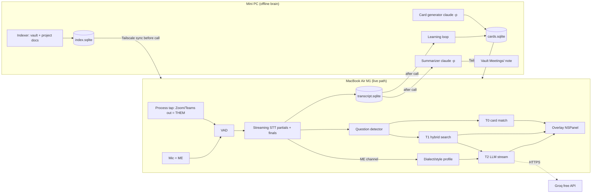

# 03 TDD — Hamsa technical design

> Draft v1, 2026-10-22. Facts marked **[VERIFY]** must be re-checked in the task that uses them.

## Hardware reality (drives every choice)
| Device | Spec | Role |
|---|---|---|
| MacBook Air M1, 8 GB RAM (memory: `project-macnook-memory-budget`) | ANE + Metal, RAM is the hard limit | Runs the **whole live path**: capture, STT, matching, overlay. Must work with the mini PC unreachable. |
| Mini PC i5-10400T, 31 GB RAM, no GPU | CPU only, always on, has the vault | Runs the **offline brain**: indexing, card generation, summaries, learning loop. Never on the < 1 s path. |
| Link | Tailscale (installed on both) | Sync of indexes/cards (minutes, not ms) |

Live-path RAM budget on the Mac: **≤ 1.5 GB** total for Hamsa (Zoom/Teams already use 1–2 GB).

## The latency idea: 4 answer tiers, fastest first
Every question goes down the tiers in parallel; the overlay shows the best result so far and
upgrades it in place.

| Tier | What | Where | Target latency after question end | Source |
|---|---|---|---|---|
| **T0 Predicted card** | Q→A card made before the call; matched on the *partial* transcript, so it often shows **before the question ends** | Mac, in-memory | ≤ 100 ms after a partial matches | pre-meeting job |
| **T1 Snippet** | Best paragraph from vault/docs (hybrid BM25 + vector), key line highlighted | Mac, local SQLite | ≤ 150 ms | local index |
| **T2 Generated** | Short answer written from T1 chunks, streamed token by token, in the speaker's language/dialect | Groq free tier (fallback chain below) | first token ≤ 600 ms | LLM API |
| **T3 Improved** | After the call: real questions + better answers become new cards | Mini PC, `claude -p` | no limit | learning loop |

Extra speed tricks:
- **Speculative start**: when the question detector fires on a partial with confidence ≥ 0.7, start T1+T2
  immediately; cancel if the next partial changes the meaning (cosine < 0.85 to the one used).
- **Warm connection**: keep an HTTP/2 connection to the LLM open during the call (no TLS handshake per question).
- **Prompt caching by shape**: system prompt + per-meeting context fixed, only question + chunks vary.
- **Bilingual cards**: each card stores `answer_en` and `answer_ar_sa` (Saudi white dialect, English
  tech terms kept in English) — no translation at runtime.

## Tech stack (one-line why each)
| Layer | Choice | Why | Rejected |
|---|---|---|---|
| Mac app | Swift 6 + SwiftUI, AppKit `NSPanel` for overlay | Native overlay (non-activating, floating, `sharingType = .none`), direct access to Core Audio + CoreML, lowest RAM | Tauri/Electron (Meetily, Pluely): extra webview RAM on 8 GB, audio/ML via bridges |
| Audio capture | Core Audio **process taps** (macOS 14.4+) for Zoom/Teams/browser output + `AVAudioEngine` mic | Per-app system audio without a virtual driver (BlackHole) | ScreenCaptureKit audio: needs screen-record permission, heavier |
| VAD | Silero VAD via FluidAudio (Apache-2.0) | CoreML, tiny, proven | WebRTC VAD: worse on Arabic |
| Streaming STT | **Decided by benchmark T02** among: WhisperKit large-v3-turbo (MIT, ANE); `oddadmix/whisper-large-v3-arabic-dialectal-v2` (Saudi/Gulf WER 0.169 self-reported) converted to CoreML; Apple `SpeechTranscriber` (macOS 26) if `ar-SA` actually downloads **[VERIFY]** | Arabic dialect quality and ANE speed both unknown on this Mac; measure, don't guess | Parakeet: no Arabic; cloud STT: not free + adds 200 ms+ |
| Embeddings | `model2vec` static multilingual model (MIT) on Mac (≈ 1 ms/query) for T0 matching; `multilingual-e5-small` for T1 chunk vectors **[VERIFY Arabic quality in T05]** | Static embeddings need no GPU and almost no RAM | bge-m3: ~1.1 GB, too big for Mac live path |
| Local index | SQLite + FTS5 (BM25) + `sqlite-vec` (Apache-2.0) | One file, built on mini PC, copied to Mac | Qdrant/Chroma: a server for ~10k chunks is overkill |
| Fast LLM (T2) | Groq free tier, model chosen in T03 from `openai/gpt-oss-120b`, `qwen/qwen3-32b`, `llama-3.3-70b-versatile` **[VERIFY limits + Arabic quality]**; fallback: Gemini Flash free tier → Cerebras free → "snippet only" | Fastest free TTFT; OpenAI-compatible API | GLM Coding Plan: its terms limit it to supported coding tools, so it must not be called from this app; Claude API: not free |
| Offline brain | Python 3.12 + FastAPI service `hamsa-brain` on mini PC, systemd user unit | Indexing/card jobs; already the owner's always-on box | Running jobs on the Mac: RAM |
| Card + summary writer | `claude -p` (Claude Code headless, existing subscription) on mini PC; GLM only via its supported coding tools for *building* the app | Best quality, no extra cost, no time limit | Local LLM on i5 CPU: too slow/weak for Arabic |
| Notes output | Markdown files in `ObsidianVault/Meetings/YYYY-MM-DD <title>.md` | Owner already lives in the vault | Separate DB UI |
| TTS (only if F8 approved) | Kokoro (already on the Mac per memory) or Apple `AVSpeechSynthesizer` ar-SA voice | Free, local | — |

## Architecture

## Language and dialect rule
- STT gives per-segment language (`ar` / `en`). The **ME** channel's last 3 minutes define the
  owner's current register: Saudi Arabic, English, or mixed.
- T0 picks `answer_ar_sa` or `answer_en` by the *asker's* last segment language; when the owner has
  been mixing, show Arabic sentence with English tech terms (how the owner actually talks).
- T2 prompt gets 3 short real lines from the ME channel as a style sample + rule: "Answer in the
  same language and dialect as these lines. Keep product names and tech terms in English. Max 3 lines."

## Key tech decisions (mini-ADRs)
1. **Live path is 100% Mac-local except T2.** Alternative: stream audio to mini PC. Rejected: no GPU,
   and network jitter would break the < 1 s goal when the owner is not at home.
2. **Prediction beats generation.** Alternative: always call an LLM. Rejected: no free LLM gives
   reliable < 1 s end-to-end from KSA; cards are instant and pre-checked.
3. **Native Swift, borrow from open source.** Take Meetily's (MIT) summary templates and AudioCap's
   (BSD-2) process-tap code as reference, not as a fork. Alternative: fork Meetily. Rejected: Rust/Next
   webview stack, fast-moving upstream with a PRO split, and the live overlay path is the part it lacks.
4. **STT engine chosen by measured Saudi-Arabic WER + latency (T02), not by reputation.**
5. **Mac app runs without the mini PC.** Last synced index/cards are used; summary is queued until reachable.

## Cost
All SAR 0/month: on-device models, Groq/Gemini free tiers, existing Claude subscription, existing hardware.
Apple Developer account not needed (local self-signed build; process taps need only the
`NSAudioCaptureUsageDescription` permission **[VERIFY]**).

## Verification map (feature → command → expected output)
| Feature | Command | Expected |
|---|---|---|
| F1 capture | `hamsa-cli capture --seconds 10 --out /tmp/cap` (Mac) | two WAV files `them.wav`, `me.wav`, both RMS > -50 dBFS while a YouTube video + speech play |
| F2 STT | `hamsa-bench wer --set bench/ar-sa` | prints `WER<=0.25` and `partial_p50_ms<=500`, exit 0 |
| F3 cards | `hamsa-brain cards build --project taweed && hamsa-brain cards stats --project taweed` | `cards>=50 bilingual=100% sources=100%` |
| F4 match+overlay | `hamsa-bench latency --replay bench/calls/taweed-01.wav` | `t0_p50_ms<=100 t1_p50_ms<=150 first_text_p50_ms<=800` |
| F5 generated | `hamsa-bench llm --n 50` | `ttft_p50_ms<=600 errors=0` |
| F6 summary | `hamsa-brain summarize --meeting <id>` | vault file `Meetings/<date> <title>.md` with sections Summary / Decisions / Action items / Open questions |
| F7 learning | `hamsa-brain learn --meeting <id> && hamsa-brain cards stats --project taweed` | `pending_review` count increases by number of unmatched questions |
| Overlay hidden from share | manual: share screen in Zoom to a 2nd account, screenshot remote view | overlay not visible remotely |
