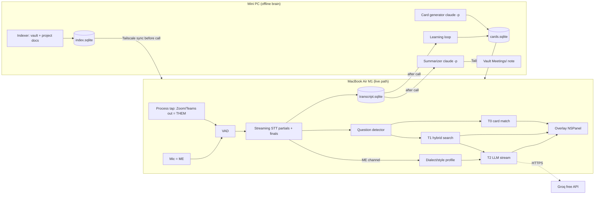

# 03 TDD — Hamsa technical design

> Draft v1, 2026-10-22. Facts marked **[VERIFY]** must be re-checked in the task that uses them.

## Hardware reality (drives every choice)
| Device | Spec | Role |
|---|---|---|
| MacBook Air M1, 8 GB RAM, macOS 26.6.2 (from vault notes 2026-09-04 / 2026-10-04, not live-checked; T00 confirms) | ANE + Metal, RAM is the hard limit | Runs the **whole live path**: capture, STT, matching, overlay. Must work with the mini PC unreachable. |
| Mini PC i5-10400T, 31 GB RAM, no GPU | CPU only, always on, has the vault | Runs the **offline brain**: indexing, card generation, summaries, learning loop. Never on the < 1 s path. |
| Link | Tailscale (installed on both) | Sync of indexes/cards (minutes, not ms) |

Live-path RAM budget on the Mac: **≤ 1.5 GB** total for Hamsa (Zoom/Teams already use 1–2 GB).

## The latency idea: 4 answer tiers, fastest first
Every question goes down the tiers in parallel; the overlay shows the best result so far and
upgrades it in place.

| Tier | What | Where | Target latency after question end | Source |
|---|---|---|---|---|
| **T0 Predicted card** | Q→A card made before the call; matched on the *partial* transcript, so it often shows **before the question ends** | Mac, in-memory | ≤ 100 ms after a partial matches | pre-meeting job |
| **T1 Snippet** | Best paragraph from vault/docs (hybrid BM25 + vector), key line highlighted | Mac, local SQLite | ≤ 150 ms | local index |
| **T2 Generated** | Short answer written from T1 chunks, streamed token by token, in the speaker's language/dialect | Groq free tier (fallback chain below) | first token ≤ 1.5 s after question end (API TTFT ≤ 600 ms) | LLM API |
| **T3 Improved** | After the call: real questions + better answers become new cards | Mini PC, `claude -p` | no limit | learning loop |

Extra speed tricks:
- **Speculative start**: when the question detector fires on a partial with confidence ≥ 0.7, start T1+T2
  immediately; cancel if the top-1 card or the top-3 chunks change on the next partial.
- **Warm connection**: keep an HTTP/2 connection to the LLM open during the call (no TLS handshake per question).
- **Prompt caching by shape**: system prompt + per-meeting context fixed, only question + chunks vary.
- **Bilingual cards**: each card stores `answer_en` and `answer_ar_sa` (Saudi white dialect, English
  tech terms kept in English) — no translation at runtime.

## Tech stack (one-line why each)
| Layer | Choice | Why | Rejected |
|---|---|---|---|
| Mac app | Swift 6 + SwiftUI, AppKit `NSPanel` for overlay | Native overlay (non-activating, floating, `sharingType = .none`), direct access to Core Audio + CoreML, lowest RAM | Tauri/Electron (Meetily, Pluely): extra webview RAM on 8 GB, audio/ML via bridges |
| Audio capture | Core Audio **global tap on all processes except Hamsa** (macOS 14.4+), re-created on default-output-device change; `AVAudioEngine` mic with voice-processing IO | Catches Zoom/Teams/browser helper processes without per-PID lists; no virtual driver (BlackHole) | Per-PID tap: misses helpers (`CptHost`, Teams/Chrome helpers); ScreenCaptureKit audio: heavier |
| Headphones | **Required** for clean me/them split. On speakers the app shows "echo risk" and drops THEM-detections that are > 0.9 similar to the mic segment at the same time | Mic hears the speakers otherwise; detector would fire on echoes | — |
| Signing | Stable local code-signing identity (free Apple ID "Personal Team" or self-signed cert in Keychain) | TCC mic/audio grants reset on every rebuild with ad-hoc signing | ad-hoc `-` signing |
| VAD | Silero VAD via FluidAudio (Apache-2.0) | CoreML, tiny, proven | WebRTC VAD: worse on Arabic |
| Streaming STT | **Decided by T02.** Candidates: (a) WhisperKit large-v3-turbo in chunked windows (step 1–2 s, window 5 s; Whisper is NOT natively streaming, partials are re-decodes); (b) Apple `SpeechTranscriber` `ar-SA` if macOS 26 and the asset downloads (checked in T00); (c) Saudi fine-tune `oddadmix/whisper-large-v3-arabic-dialectal-v2` only via separate time-boxed task T02b (1 day CoreML conversion) | Arabic dialect quality and ANE speed both unknown on this Mac; measure, don't guess | Parakeet: no Arabic; cloud STT: not free + adds 200 ms+ |
| Embeddings | **One model on both sides**: `intfloat/multilingual-e5-small` (384-d), CoreML on Mac, PyTorch/ONNX on brain; parity checked in T05b (cosine ≥ 0.999) **[VERIFY dialect → English-doc retrieval in T05]** | One model = no parity drift; ~235 MB fp16 (measured in T05b) | model2vec: no Swift port, weak cross-lingual; bge-m3: ~1.1 GB |
| Local index | Brain: SQLite + FTS5 (BM25) + `sqlite-vec`. Mac: system SQLite for FTS5 only; vectors loaded into memory as `[Float]`, brute-force dot product (≤ 20k vectors, target < 5 ms) | No static SQLite build on Mac; extension loading not needed | Qdrant/Chroma: a server for ~10k chunks is overkill |
| Fast LLM (T2) | Groq free tier, model chosen in T03 from `openai/gpt-oss-120b`, `qwen/qwen3-32b`, `llama-3.3-70b-versatile` **[VERIFY limits + Arabic quality]**; fallback: Gemini Flash free tier → Cerebras free → "snippet only". Provider is a setting (OpenAI-compatible), so a paid Claude Haiku or GLM API key can be dropped in later | Fastest free TTFT; T2 only rewrites 1–3 retrieved snippets, so raw speed matters more than model quality here | **Claude via subscription (`claude -p`)**: measured on the mini PC 2026-10-23: first token 5.3–6.3 s (Haiku and Sonnet, cold; Claude Code startup + hooks), too slow for live; `--bare` mode skips the keychain, so it cannot use the subscription. **GLM Coding Plan**: its terms limit it to supported coding tools, so calling it from this app risks the plan. Paid Claude/GLM APIs: not free |
| Offline brain | Python 3.12 + FastAPI service `hamsa-brain` on mini PC, systemd user unit | Indexing/card jobs; already the owner's always-on box | Running jobs on the Mac: RAM |
| Card + summary writer | `claude -p` (Claude Code headless, existing subscription) on mini PC; GLM only via its supported coding tools for *building* the app | Best quality, no extra cost, no time limit — this is where Claude's quality matters: it writes every prepared answer before the call | Local LLM on i5 CPU: too slow/weak for Arabic |
| Notes output | Markdown files in `ObsidianVault/Meetings/YYYY-MM-DD <title>.md` | Owner already lives in the vault | Separate DB UI |

## Architecture

## Latency definitions (all KPIs use these)
- `t_question_end_ms` (bench) = last voiced frame of the question, **hand-labelled** in
  `bench/calls/*.labels.json`. Live runs use VAD end-of-speech; reports show VAD hangover separately.
- `partial_lag_ms` = time a partial first contains word N − time word N ended (from labels), median over words.
- `first_text_ms` = overlay shows T0 or T1 text − `t_question_end_ms`. Can be negative (card shown before the question ends).
- Budgets: T0/T1 first text p50 ≤ 800 ms. T2 first token p50 ≤ 1.5 s. The "< 1 s" promise covers T0/T1 only.

## Question detector (v1 algorithm)
Runs on every THEM partial and final:
1. Rules score: interrogative words (ar: وش، ايش، ليش، كيف، هل، متى، كم، وين، مين، فيه، تقدر؛ en: wh-words, "can/could/do/does/is/are you", "tell me", "explain"), "?" in STT output, sentence-final intonation not used (v2).
2. Card score: max cosine between the partial and all card questions/paraphrases.
3. Fire T0 at once (even mid-question) when top-1 card score ≥ `s` AND top-1 − top-2 ≥ `m`; fire T1 + T2 when
   `rules_score ≥ 1 AND final segment`. `s` and `m` are calibrated on calls 1–3 in T09 from the e5 score
   histogram (e5 cosines bunch in ~0.7–1.0, so no fixed 0.8x value). A partial is re-embedded only after it grew by ≥ 2 words.
Statements without a question word still trigger T0 if the card score is high.

## Style sample for T2
Take the last 3 ME final segments of ≥ 4 words from the past 3 minutes; if none, use the
`lang` of the asker's segment and the default register "Saudi white dialect, English tech terms".

## Plan B (if T02 finds no engine that passes)
Expected default if WhisperKit chunked `partial_lag_p50_ms` > 700. Design the overlay so it works in this mode from day 1.
"Chunked mode": 2–3 s STT lag accepted; no mid-question T0; T0/T1 fire on finals only; manual ask
(⌥⌘Space) becomes the primary trigger. PRD latency target is restated as "< 1 s after the final segment".

## Plan B for screen-share hiding (if T04b fails)
Overlay moves to a second surface: the iPhone/iPad via the existing Jarvis Companion app, or a
display that is not shared. Decision recorded in `docs/adr/003-overlay-surface.md`.

## Language and dialect rule
- STT gives per-segment language (`ar` / `en`). The **ME** channel's last 3 minutes define the
  owner's current register: Saudi Arabic, English, or mixed.
- T0 picks `answer_ar_sa` or `answer_en` by the *asker's* last segment language; when the owner has
  been mixing, show Arabic sentence with English tech terms (how the owner actually talks).
- T2 prompt gets 3 short real lines from the ME channel as a style sample + rule: "Answer in the
  same language and dialect as these lines. Keep product names and tech terms in English. Max 3 lines."

## Key tech decisions (mini-ADRs)
1. **Live path is 100% Mac-local except T2.** Alternative: stream audio to mini PC. Rejected: no GPU,
   and network jitter would break the < 1 s goal when the owner is not at home.
2. **Prediction beats generation.** Alternative: always call an LLM. Rejected: no free LLM gives
   reliable < 1 s end-to-end from KSA; cards are instant and pre-checked.
3. **Native Swift, borrow from open source.** Take Meetily's (MIT) summary templates and AudioCap's
   (BSD-2) process-tap code as reference, not as a fork. Alternative: fork Meetily. Rejected: Rust/Next
   webview stack, fast-moving upstream with a PRO split, and the live overlay path is the part it lacks.
4. **STT engine chosen by measured Saudi-Arabic WER + latency (T02), not by reputation.**
5. **Mac app runs without the mini PC.** Last synced index/cards are used; summary is queued until reachable.

## Cost
All SAR 0/month: on-device models, Groq/Gemini free tiers, existing Claude subscription, existing hardware.
Paid Apple Developer account not needed (local build with a stable free signing identity; process
taps need the `NSAudioCaptureUsageDescription` permission **[VERIFY in T04]**).
Note: `claude -p` jobs draw on the subscription's usage limits; card builds are capped at 1 run per
meeting and queued behind other work **[VERIFY limits in T06]**.

## Verification map (feature → command → expected output)
| Feature | Command | Expected |
|---|---|---|
| F1 capture | `swift run hamsa-cli capture --seconds 10 --out /tmp/cap` (Mac) | two WAV files `them.wav`, `me.wav`, both RMS > -50 dBFS while a YouTube video + speech play |
| F2 STT | `swift run bench-wer --set bench/ar-sa --engine all --with-zoom-load` | winner: `wer_ar<=0.30 wer_en<=0.15 partial_lag_p50_ms<=700 rss_mb<=900 pageouts_growth=0` |
| F3 cards | `hamsa-brain cards build --project taweed && hamsa-brain cards stats --project taweed` | `cards>=50 bilingual=100% sources=100%` |
| F4 match+overlay | `swift run bench-latency --replay bench/calls/call-05.wav --labels bench/calls/call-05.labels.json` | `t0_match_p50_ms<=100 t1_p50_ms<=150 first_text_p50_ms<=800` |
| F5 generated | `swift run bench-llm --n 50 --with-context` | `ttft_p50_ms<=600 errors=0` |
| F6 summary | `hamsa-brain summarize --meeting <id>` | vault file `Meetings/<date> <title>.md` with sections Summary / Decisions / Action items / Open questions |
| F7 learning | `hamsa-brain learn --meeting <id> && hamsa-brain cards stats --project taweed` | `pending_review` count increases by number of unmatched questions |
| Overlay hidden from share | T04b: share screen in Zoom, Teams, Meet (browser) to a 2nd account; `jarvis-screen frame` of the remote view | panel absent in all 3, else Plan B |
| Endurance | `swift run bench-soak --hours 3` with a looped call playing | Hamsa RSS ≤ 1.5 GB at hour 3, swap growth < 500 MB, no crash |
