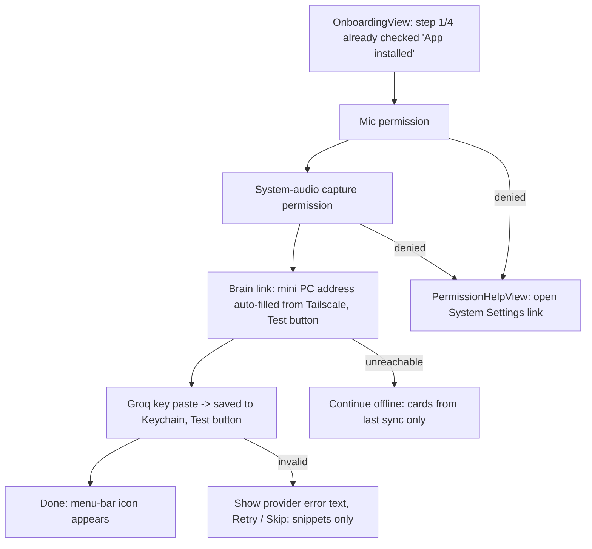

# 04 App Flow — Hamsa

> Draft v1, 2026-10-22. Screen names below are the SwiftUI view / file names.

## Onboarding (first launch only, ~2 min)

Smart defaults: brain address prefilled, project = last used, language = auto.

## Journey 1 — Prepare a call (before)
1. Menu bar → **PrepareMeetingView**. Fields: Title (default "<App> call <date>"; app name from
   `NSWorkspace` frontmost app, no Accessibility permission needed), Confidential toggle (off),
   Project (picker from `projects`, default last used), optional agenda text.
2. Button **"Prepare 60 answers for Taweed"** → brain runs card job (claude -p, 2–10 min).
   Progress shows "Indexing ✓ → Predicting questions … → Writing answers …".
3. Done → cards synced to Mac. Status "Ready: 64 cards, index 2 h old".
- Error: brain unreachable → "Using 41 cards from last sync (3 days old)". Start still allowed.
- Error: claude -p fails → keep old cards, show error line, offer Retry.

## Journey 2 — During the call
1. **Start** (menu bar or ⌥⌘H). Red dot in menu bar = recording. Menu offers "Copy consent line".
   No headphones detected → yellow "echo risk" badge.
2. **OverlayPanel** appears (top-right, 360 px wide, max 4 lines, 85% opacity, click-through
   except its buttons, hidden from screen share).
3. Question detected on THEM channel → card slides in:
   - Header: the question as heard (1 line, grey).
   - Body: T0 card answer, or T1 snippet with highlighted line, upgraded in place by T2 stream.
   - Footer: source file name · tier badge (Card / Note / AI) · 👍 · 👎 · 📌 pin.
4. Cards auto-fade after 20 s unless pinned; last 5 kept in a stack (⌥⌘↑ / ⌥⌘↓ to browse).
5. Manual ask: ⌥⌘Space → one-line input in overlay → same tiers.
- Error: STT engine crashes → overlay shows "Transcription restarted" and restarts within 2 s; audio is
  still written to disk so the summary is not lost.
- Error: LLM quota / network → tier badge shows "AI off", T0/T1 still work.
- Error: no answer found → card shows "Not in your notes" (never a made-up answer).

## Journey 3 — After the call
1. **Stop** → audio + transcript closed, upload queued to brain.
2. **SummaryReadyNotification** (≤ 2 min): opens the vault note in Obsidian.
3. **ReviewQuestionsView**: list of questions heard that had no card or got 👎. Per row:
   Accept AI draft / Edit / Discard. Accepted → card for next call.
- Error: brain offline → "Summary queued, will run when mini PC is reachable".
- Confidential + "local only" (`claude_allowed=0`): no upload, transcript stays on the Mac, notification says
  "Summary skipped (confidential)".

## Screen list (file names)
`MenuBarView`, `OnboardingView`, `PermissionHelpView`, `PrepareMeetingView`, `OverlayPanel`,
`AnswerCardView`, `AskBarView`, `ReviewQuestionsView`, `SettingsView` (hotkeys, overlay position,
opacity, provider chain, data retention), `MeetingListView` (past meetings, open note, delete).

## Action map
| Action | Trigger | Result |
|---|---|---|
| Prepare | button in PrepareMeetingView | `POST brain /cards/build` |
| Start / Stop | menu bar, ⌥⌘H | capture on/off, `meetings` row opened/closed |
| Ask | ⌥⌘Space | manual question into tier pipeline |
| 👍 / 👎 | AnswerCardView | `answer_events.rating` |
| Pin | AnswerCardView | card stays until unpinned |
| Hide overlay | ⌥⌘O | overlay hidden, pipeline keeps running |
| Delete meeting | MeetingListView | deletes audio + transcript + vault note after confirm |

## Overlay visual rules (no separate design brief — personal tool)
- System font (SF Pro / SF Arabic), RTL layout when the answer is Arabic.
- One accent colour only: tier badge. No gradients, no glass, no animation except a 150 ms slide-in.
- Text ≥ 15 pt; readable at a glance while talking.
