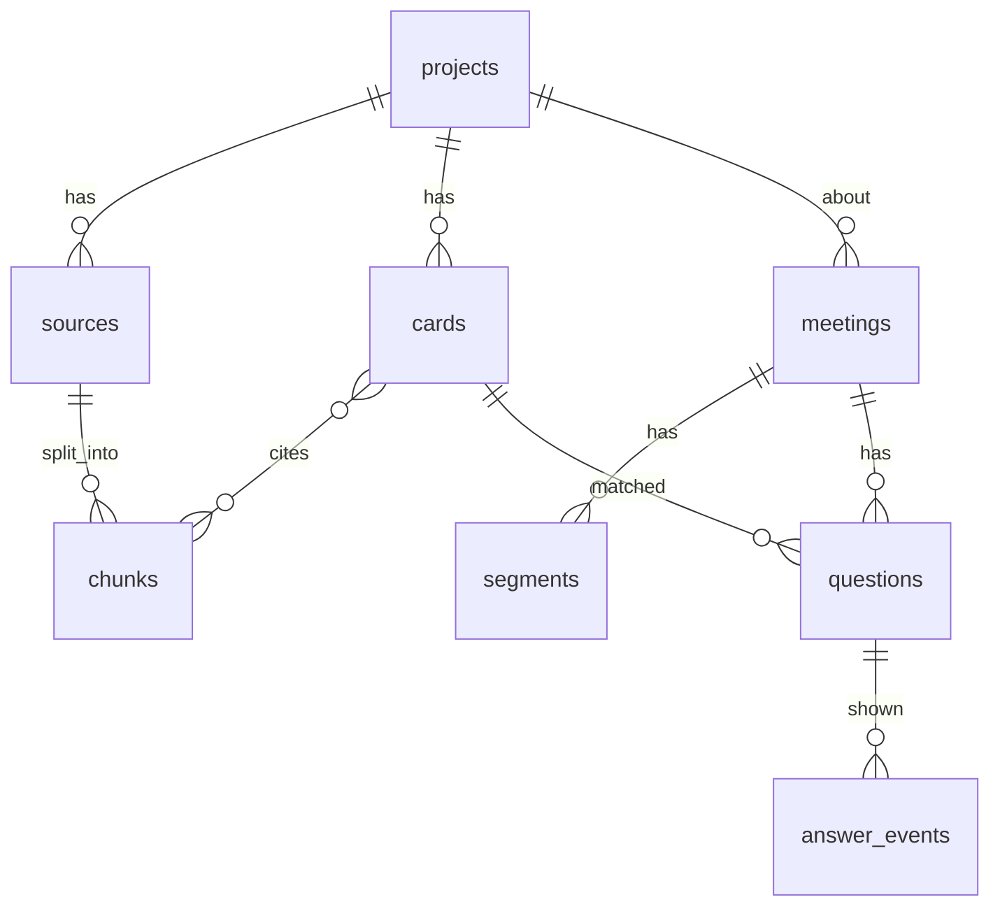

# 06 Data Schema — Hamsa

> Draft v1, 2026-10-22. No payments, no accounts → no auth/webhook tables.
> Three SQLite files. Brain owns `index.sqlite` + `cards.sqlite` (read-only copies on Mac).
> Mac owns `live.sqlite` (uploaded to brain after the call).

## index.sqlite (brain → Mac)
**projects** — `id TEXT PK` (slug, e.g. `taweed`), `name TEXT NOT NULL`, `doc_globs TEXT NOT NULL`
(JSON list of paths: vault folders + repo `docs/`), `updated_at INTEGER NOT NULL`.

**sources** — `id INTEGER PK`, `project_id TEXT FK→projects`, `path TEXT NOT NULL`, `sha256 TEXT NOT NULL`,
`mtime INTEGER`, `UNIQUE(project_id, path)`. Re-index only when sha changes.

**chunks** — `id INTEGER PK`, `source_id INTEGER FK→sources ON DELETE CASCADE`, `heading TEXT`,
`text TEXT NOT NULL` (≤ 800 chars), `lang TEXT CHECK(lang IN ('ar','en','mixed'))`, `ord INTEGER`.
- `chunks_fts` — FTS5 virtual table on `heading, text` (tokenizer `unicode61 remove_diacritics 2` for Arabic).
- `chunks_vec` — `sqlite-vec` `vec0(embedding float[384])`, rowid = `chunks.id`.

Excluded from indexing always: `Secrets/`, any file with `secret|password|token` in path, `.bak*`.

## cards.sqlite (brain → Mac)
**cards** — `id INTEGER PK`, `project_id TEXT FK`, `question_en TEXT NOT NULL`, `question_ar TEXT NOT NULL`,
`paraphrases TEXT NOT NULL` (JSON list, 3–6, both languages), `answer_en TEXT NOT NULL` (≤ 3 lines),
`answer_ar_sa TEXT NOT NULL`, `source_chunk_ids TEXT NOT NULL` (JSON, ≥ 1),
`status TEXT CHECK(status IN ('active','pending_review','retired')) NOT NULL`,
`origin TEXT CHECK(origin IN ('predicted','learned','manual'))`, `uses INTEGER DEFAULT 0`,
`thumbs_up INTEGER DEFAULT 0`, `thumbs_down INTEGER DEFAULT 0`, `version INTEGER NOT NULL DEFAULT 1`,
`updated_at INTEGER NOT NULL`. Index `(project_id, status)`.
- `cards_vec` — `vec0(embedding float[256])` over question + each paraphrase (rowid = card_id*16 + n).
- Rule: a card with no source chunk is rejected at build (no unsourced answers).

## live.sqlite (Mac → brain after call)
**meetings** — `id TEXT PK` (UUID), `project_id TEXT`, `title TEXT`, `app TEXT` (zoom/teams/browser),
`started_at INTEGER NOT NULL`, `ended_at INTEGER`, `audio_dir TEXT`, `summary_path TEXT`,
`status TEXT CHECK(status IN ('live','queued','summarized','deleted'))`.

**segments** — `id INTEGER PK`, `meeting_id TEXT FK ON DELETE CASCADE`, `channel TEXT CHECK(channel IN ('me','them'))`,
`t_start_ms INTEGER`, `t_end_ms INTEGER`, `text TEXT NOT NULL`, `lang TEXT`, `is_final INTEGER NOT NULL`.
Index `(meeting_id, t_start_ms)`.

**questions** — `id INTEGER PK`, `meeting_id TEXT FK`, `segment_id INTEGER FK`, `text TEXT`,
`detect_conf REAL`, `t_detect_ms INTEGER`, `t_question_end_ms INTEGER`, `matched_card_id INTEGER NULL`,
`match_score REAL`, `manual INTEGER DEFAULT 0`.

**answer_events** — `id INTEGER PK`, `question_id INTEGER FK`, `tier TEXT CHECK(tier IN ('T0','T1','T2'))`,
`t_shown_ms INTEGER NOT NULL`, `text TEXT`, `provider TEXT NULL`, `rating INTEGER NULL CHECK(rating IN (-1,1))`.
- **latency_events** is a view: `t_shown_ms - t_question_end_ms` per tier → the KPI source.

## Retention (privacy)
- Audio WAV: deleted 30 days after summary (setting; 0 = keep forever).
- Transcript + summary: kept until the owner deletes the meeting.
- Delete meeting = delete audio dir + rows + vault note (confirm dialog).

## Brain API (FastAPI, Tailscale-only bind, bearer token from Keychain/`~/.config/hamsa/token`)
| Method | Path | Does |
|---|---|---|
| POST | `/index/refresh?project=` | re-index changed sources |
| POST | `/cards/build?project=&agenda=` | generate predicted cards (async job id) |
| GET | `/jobs/{id}` | job status |
| GET | `/sync/{file}` | download `index.sqlite` / `cards.sqlite` (ETag) |
| POST | `/meetings/{id}/upload` | upload `live.sqlite` slice + audio |
| POST | `/meetings/{id}/summarize` | write vault note |
| POST | `/meetings/{id}/learn` | turn unmatched questions into `pending_review` cards |
